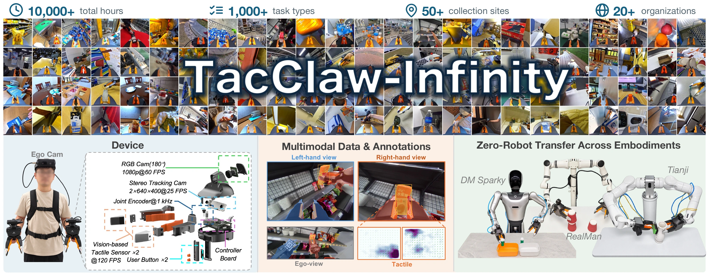

<h1 align="center">TacClaw-Infinity</h1>

<h3 align="center">A Large-Scale Vision-Tactile-Language-Action Dataset<br>for Dexterous Manipulation</h3>

<p align="center">
  <a href="https://daimon-robotics.github.io/tacclaw-infinity-page/"></a>
  <a href="https://arxiv.org/abs/2610.20320"></a>
  <a href="https://huggingface.co/datasets/daimonrobotics/Daimon-Infinity"></a>
  <a href="https://modelscope.cn/datasets/daimonrobotics/Daimon-Infinity"></a>
</p>

<p align="center">
  <a href="#highlights">Highlights</a> ·
  <a href="#news">News</a> ·
  <a href="#dataset">Dataset</a> ·
  <a href="#code">Code</a> ·
  <a href="#data-plan">Data Plan</a> ·
  <a href="#todo">To-do List</a> ·
  <a href="#more-works">More Works</a> ·
  <a href="#citation">Citation</a>
</p>

<p align="center">
  <a href="https://daimon-robotics.github.io/tacclaw-infinity-page/">
    
  </a>
</p>

**TacClaw-Infinity** is a large-scale Vision-Tactile-Language-Action (VTLA) dataset for contact-rich manipulation. Demonstrations are collected with **TacClaw**, a tactile-enabled handheld interface that records synchronized visual observations, fingertip tactile signals, and end-effector trajectories without requiring a target robot during collection.

<a name="highlights"></a>
## ✨ Highlights

### 📊 Large Scale

| Devices | Tasks | Hours | Episodes | Frames |
| :---: | :---: | :---: | :---: | :---: |
| **200+** | **1,000+** | **10,000+** | **1 million+** | **1 billion+** |

### 🌍 High Diversity

Worldwide collection contributed by **20+ organizations** across **50+ locations**, spanning **homes, laboratories, hotels, industrial workplaces, retail stores, outdoor environments**, and more.

### 🖐️ Omni Modality

**High-resolution Tactile + Vision + Language + Action**

Four synchronized modalities connect contact, perception, instruction, and motion for contact-rich manipulation.

<a name="news"></a>
## 📢 News

<!-- Add confirmed announcements here, newest first: **[YYYY-MM-DD]** Announcement. -->
- **[2026-10-15]** Our paper is now publicly available on [arXiv](https://arxiv.org/abs/2610.20320) ([PDF](https://arxiv.org/pdf/2610.20320)).
- **[2026-10-13]** Robot replay and kinematic evaluation tools are available for [Tianji](robot_executability_checks/tianji/), [DM-Sparky](robot_executability_checks/dm-sparky/), and [RealMan](robot_executability_checks/realman/).
- **[2026-10-10]** Explore the [project website](https://daimon-robotics.github.io/tacclaw-infinity-page/), [manuscript PDF](https://daimon-robotics.github.io/tacclaw-infinity-page/assets/paper.pdf), and dataset portals on [Hugging Face](https://huggingface.co/datasets/daimonrobotics/Daimon-Infinity) and [ModelScope](https://modelscope.cn/datasets/daimonrobotics/Daimon-Infinity).
- **Coming soon:** policy training/evaluation code.

<a name="dataset"></a>
## 🗂️ Dataset

**A subset of TacClaw-Infinity is now publicly available** on Hugging Face and ModelScope under **Daimon-Infinity**.

| Platform | Dataset portal |
| :--- | :--- |
| 🤗 Hugging Face | [Daimon-Infinity](https://huggingface.co/datasets/daimonrobotics/Daimon-Infinity) |
| 🧩 ModelScope | [Daimon-Infinity](https://modelscope.cn/datasets/daimonrobotics/Daimon-Infinity) |

<a name="code"></a>
## 🤖 Robot Replay and Evaluation

<details>
<summary><strong>Robot guides, setup, and evaluation commands</strong></summary>

Tools for replaying LeRobot v3 trajectories, evaluating inverse-kinematics reachability and manipulability, and visualizing robot workspaces are organized by robot in [`robot_executability_checks/`](robot_executability_checks/):

| Robot | Directory and guide | Main workflow |
| :--- | :--- | :--- |
| Tianji | [tianji/](robot_executability_checks/tianji/) | Aik7 trajectory replay and dual-arm kinematic evaluation |
| DM-Sparky | [dm-sparky/](robot_executability_checks/dm-sparky/) | Fixed-torso evaluation and 18-DoF base, knee, waist, and dual-arm solving |
| RealMan RM75-B | [realman/](robot_executability_checks/realman/) | Dual-arm assembly, episode evaluation, and replay video rendering |

Each directory contains its own model assets, configuration, dependencies, scripts, and tests. Run commands from the selected robot directory and keep its Python environment separate. The original compatibility workflows are retained; use the robot-specific commands below.

### Quick start

Requirements: Python with `venv`, CMake, a C++17 compiler, and Eigen3 headers (`libeigen3-dev` on Debian/Ubuntu). Video rendering also requires FFmpeg.

```bash
git clone https://github.com/daimon-robotics/TacClaw-Infinity.git
cd TacClaw-Infinity/robot_executability_checks/tianji  # or dm-sparky / realman
./setup.sh
source .venv/bin/activate
export LEROBOT_DATASET=/absolute/path/to/your_lerobot_v3_dataset
```

Before evaluating a dataset, check the selected robot guide's coordinate-frame, TCP, and scene-registration requirements. LeRobot v3 describes the data format; it does not guarantee the required calibration frame.

**Tianji** — from `robot_executability_checks/tianji/`:

```bash
./evaluate.sh "$LEROBOT_DATASET" outputs/tianji_arm_quality --episodes all
python scripts/replay_lerobot.py --dataset "$LEROBOT_DATASET" --episode 0 --dry-run
```

**DM-Sparky** — from `robot_executability_checks/dm-sparky/`:

```bash
./evaluate.sh "$LEROBOT_DATASET" outputs/dm_sparky_quality --robot mobile-humanoid
# Allow base, knee, and waist motion in the kinematic solver:
python scripts/evaluate_humanoid_mobility.py \
  --dataset "$LEROBOT_DATASET" --episodes all \
  --output outputs/dm_sparky_mobility
```

**RealMan RM75-B** — from `robot_executability_checks/realman/`:

```bash
python scripts/evaluate_realman_episode.py \
  --dataset "$LEROBOT_DATASET" \
  --urdf models/ros_packages/dual_rm75_b_description/urdf/dual_rm75_b.urdf \
  --scene-config config/realman_dm_tr01_scene.json \
  --episode 0 --output outputs/realman_ep0_quality
```

These tools provide simulation and kinematic analysis. They do not measure policy task success or certify real-robot safety. Policy training and task-level evaluation code remain forthcoming. See [the import notes](docs/CODE_IMPORT.md) for source versions and directory isolation.

</details>

<a name="data-plan"></a>
## 📈 Data Plan

The current collection comprises **10,000+ hours** and **1 million+ episodes**. Future collection milestones will be listed below once their quantities and dates are confirmed.

<!-- Future targets are intentionally unannounced. Add only confirmed cumulative collection targets and dates; track public dataset releases separately. -->
| Collection milestone | Cumulative hours | Cumulative episodes | Target date | Status |
| :--- | :---: | :---: | :---: | :--- |
| Current collection | 10,000+ | 1 million+ | — | Current scale |
| Next collection milestone | To be announced | To be announced | To be announced | Planned |
| Longer-term expansion | To be announced | To be announced | To be announced | Planned |

*Collection totals and publicly downloadable data may differ; dataset availability is listed on the two portals above.*

<a name="todo"></a>
## ✅ To-do List

- [x] Publish the project website and manuscript PDF.
- [x] Add the Hugging Face and ModelScope dataset portals.
- [x] Add the arXiv paper link and update the citation.
- [ ] Release data-loading and preprocessing utilities.
- [x] Release robot replay, kinematic evaluation, and workspace visualization tools.
- [ ] Release policy training and task-level evaluation code with usage instructions.
- [ ] Announce the next data collection targets and timeline.

Robot replay and kinematic evaluation tools are available in the [Code section](#code). Additional data-processing and policy-learning utilities will be announced here.

<a name="more-works"></a>
## 🔎 More Works

Explore more projects from [**Daimon Robotics**](https://github.com/daimon-robotics).

<!-- Add confirmed related works here as: [Project title](URL) — one-sentence description. -->

<a name="paper"></a>
## 📄 Paper

Read the paper on [**arXiv**](https://arxiv.org/abs/2610.20320) or open the [**PDF**](https://arxiv.org/pdf/2610.20320). Visit the [**project website**](https://daimon-robotics.github.io/tacclaw-infinity-page/) for the video, figures, and results.

<a name="citation"></a>
## 📝 Citation

If you use TacClaw-Infinity in your research, please cite our arXiv paper:

```bibtex
@misc{zhu2026tacclawinfinity,
  title  = {TacClaw-Infinity: A Large-Scale Vision-Tactile-Language-Action Dataset for Dexterous Manipulation},
  author = {Zhu, Fucai and Zhang, Xidong and Zhang, Yichi and Wang, Yipan and Wang, Fubo and
            Wu, Zibin and Li, Kaiqi and Jiao, Jianhao and Lu, Shihan and Hu, Di and Xu, Mengdi and
            Zhu, Siyu and Long, Xiaoxiao and Yao, Yao and Cao, Xun and Xu, Zhuo and
            Hashimoto, Koichi and Chen, Qifeng and Li, Zhe and Yang, Jianfei and Lu, Haofei and
            Kragic, Danica and Yan, Shuicheng and Duan, Jianghua and Wang, Michael Yu and
            Yuan, Weihao},
  year   = {2026},
  eprint = {2610.20320},
  archivePrefix = {arXiv},
  primaryClass = {cs.RO},
  url    = {https://arxiv.org/abs/2610.20320}
}
```

---

<sub>The project website and its video and figure collection are maintained separately in <a href="https://github.com/daimon-robotics/tacclaw-infinity-page">tacclaw-infinity-page</a>.</sub>
